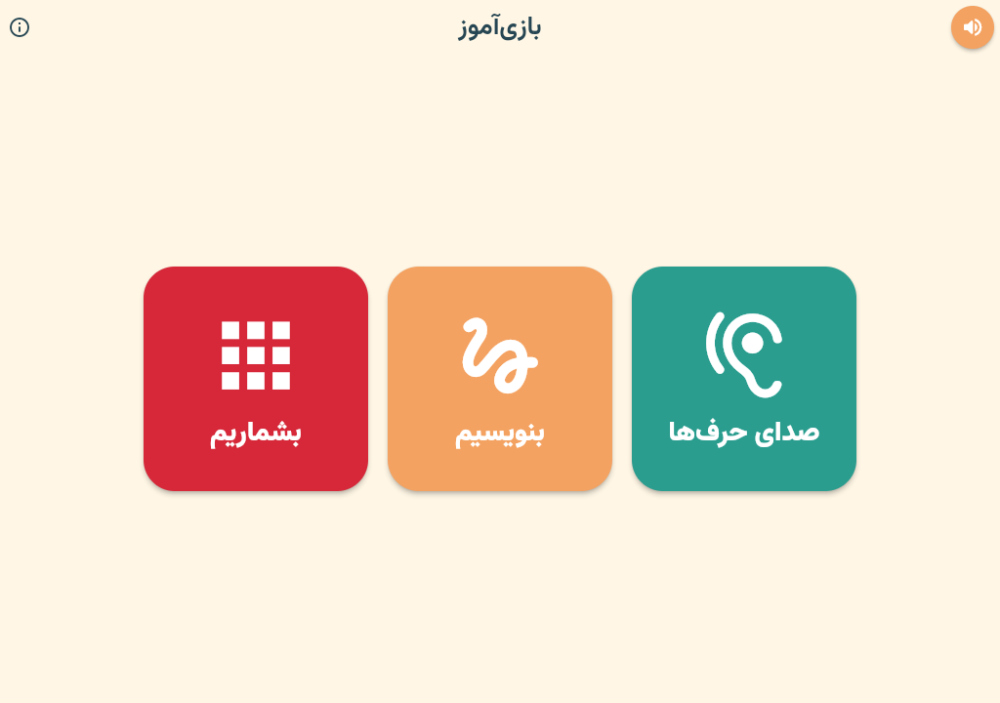
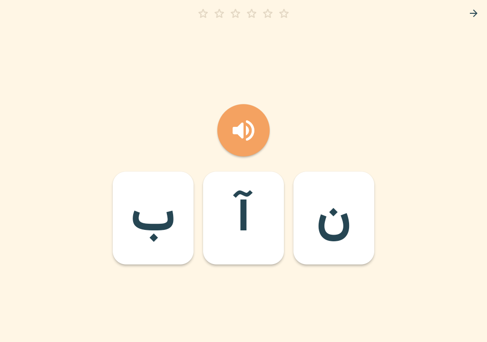
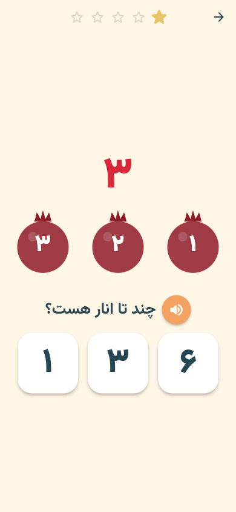

# بازی‌آموز — Persian early-learning prototype

*(Working title. The final product needs its own name: "Kitkit" and "Enuma" are trademarks of Enuma, Inc.)*

A first, small working prototype of a Persian (Farsi) learning app for **children aged 4–8 in Iran**.
It keeps the play-based approach of [Kitkit School](../README.md) but is **rebuilt from scratch** in
[Flutter](https://flutter.dev), so that it:

- shows Persian correctly: right-to-left, with letters joined and shaped the way they should be;
- runs on **Android, iOS and the web** from one set of code;
- works **completely offline** (no internet, no accounts, no tracking).

The original Kitkit School apps in this repository are **not changed**.

| Home | Letter sounds | Tracing | Counting |
|---|---|---|---|
|  |  |  |  |

## What's in the prototype

| Activity | Inspired by (Kitkit) | What the child does | What it teaches |
|---|---|---|---|
| **صدای حرف‌ها** (Letter sounds) | SoundTrain, BirdPhonics | Hears a letter and its example word, taps the matching letter among three. | Linking sounds to letter shapes. |
| **بنویسیم** (Let's write) | LetterTrace | Traces a letter with a finger: from the green circle, **right to left**, body first, **dots last**. Sees the letter's shapes at the start, middle and end of a word. | Correct stroke order and direction; that Persian letters change shape. |
| **بشماریم** (Let's count) | Counting, FeedingTime | Taps each pomegranate (each tap says the next number and shows it in Persian digits), then picks the right number. | One-to-one counting, number words, Persian digits ۱–۱۰. |

The eight letters — **آ ب د م ن ت س ر** — are the first letters taught in Iran's Grade 1 Persian
textbook (فارسی اول دبستان), in the same order.

Design choices for young children:

- **Audio first.** Instructions are spoken, and a big orange speaker button repeats them, so pre-readers can play alone.
- **No failure states.** A wrong answer fades out gently and the child tries again. A star is earned for getting it right the first time.
- **Big targets**, high contrast, and screen-reader labels for every button.

## How the content is organised (no programming needed to change it)

| What | Where |
|---|---|
| Letters, example words, tracing shapes | `lib/data/letters.dart` |
| Everything the app says aloud | `lib/data/voice_script.dart` |
| Checklist for the voice artist | `docs/RECORDING_SCRIPT.md` |
| Recordings and sound effects | `assets/audio/` |
| Colours | `lib/theme.dart` |
| Font (Vazirmatn) | `assets/fonts/` |

**Voice:** the app plays a real recording as soon as a file named as in `docs/RECORDING_SCRIPT.md`
is placed in `assets/audio/`. Until then it uses the device's own Persian text-to-speech voice if one is
installed (many Android phones have one; browsers often don't), otherwise it stays silent.

**Tracing shapes** are lists of points inside a square from 0 to 1 (0,0 = top-left). They are first
approximations: a handwriting teacher should review them, and an animator can replace them with precise paths.

## Running it (for developers)

Requires Flutter 3.50 or newer.

```bash
cd persian_prototype
flutter pub get
flutter test                                       # 13 automated checks
flutter run                                        # on a connected phone or emulator
flutter build apk --release                        # Android
flutter build web --release --no-web-resources-cdn # Web, fully offline
```

`--no-web-resources-cdn` makes the web version include everything it needs instead of downloading
parts from Google's servers, so it also works offline.

## Known limits of this prototype

- No recorded voice yet (text-to-speech fallback only).
- Short vowels ( ـَ ـِ ـُ ) and the long vowels او / ای are not included yet.
- Progress isn't saved between sessions.
- Simple drawn graphics only; no illustrations or animations yet.
- Not yet tested with children.

## Credits and licences

See [NOTICE.md](NOTICE.md).
